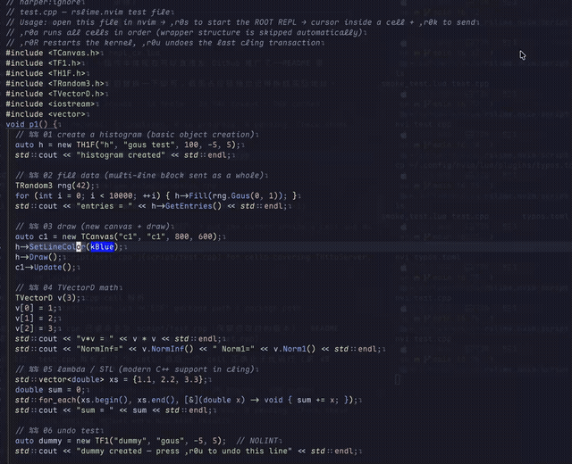

# rslime.nvim

Slime-style ROOT (CERN) REPL for Neovim. Zero dependencies — built on the internal terminal, no iron/conjure/toggleterm needed.

Organize your C++ code into Jupyter-style `// %%` cells and send them one by one to ROOT (Cling) for interactive execution. Kernel restart, `.undo`, and THttpServer visualization supported.



[▶ HD video (mp4, ~580 KB)](https://github.com/cxwx/rslime.nvim/raw/main/assets/demo.mp4)

## What is this?

C++ has no official interactive interpreter, but CERN's [ROOT](https://root.cern/) ships one: [Cling](https://github.com/root-project/cling), a C++ interpreter based on Clang/LLVM. `root -l` opens a REPL where C++ statements run immediately — the de-facto standard for HEP (high energy physics) analysis.

rslime.nvim turns that REPL into a slime workflow: keep your code in ordinary `.cpp` files, split it into cells, and push each cell to the running interpreter — like [slime](https://github.com/jpalardy/vim-slime) or a Jupyter notebook, but for C++.

## Requirements

- Neovim 0.10+
- **[CERN ROOT](https://root.cern/download/)** on your PATH (`root -l` must start) — ROOT is an *external dependency*; it bundles the Cling C++ interpreter that powers the REPL. Install via package manager (e.g. `brew install root`) or build from source.

Neovim plugin dependencies: none.

## Features

- **Cells**: split code into blocks with `// %%` headers and send the one under the cursor; LSP wrapper structure (`#include`, `main()`, …) is skipped automatically and never leaks into the REPL
- **Run all**: execute every cell in order (optional per-cell delay to watch each block's output)
- **Kernel restart**: `.q` → `gSystem->Exit(0)` → force kill, three-level fallback; the REPL comes back automatically
- **Undo**: roll back the last n cling transactions (`:RslimeUndo 3`)
- **THttpServer**: one key to start it and open the browser — inspect variables and canvases from the background
- **Clean exit**: the terminal buffer closes itself when the REPL exits; never stuck on `[Process exited 0]`

## Installation

Install with [lazy.nvim](https://github.com/folke/lazy.nvim):

```lua
{
  "cxwx/rslime.nvim",
  ft = { "cpp", "c" },
  keys = {
    { "<leader>r0s", desc = "rslime start" },
  },
  config = function()
    require("rslime").setup({
      prefix = "<leader>r0",
    })
  end,
}
```

Requirement: CERN ROOT on your PATH (`root -l` must start).

## Configuration

```lua
require("rslime").setup({
  cmd = "root -l",                 -- ROOT command to run
  position = "bottom",             -- "bottom" | "right"
  height = nil,                    -- nil = half the terminal height; position="right" uses width
  width = 80,
  startup_cmds = {},               -- cling commands sent after startup
  cell_delimiter = "^%s*//%s*%%%%",-- cell header pattern
  run_all_delay = 0,               -- >0: send cells one by one with this delay (ms)
  http_port = 8080,                -- THttpServer port
  http_open = true,                -- open the browser after starting THttpServer
  prefix = nil,                    -- nil registers no mappings
  keys = {                         -- mapping = prefix + suffix
    start = "s", toggle = "1", restart = "R", quit = "q", focus = "f",
    http = "h",
    cell = "k", line = "l", visual = "b", file = "F", undo = "u", run_all = "a",
  },
})
```

Mapping rules: `start/toggle/restart/quit/focus/http` are global; `cell/line/visual/file/undo/run_all` are buffer-local to c/cpp files. Set any suffix to `false` to disable it.

## Commands

| Command | Description |
|---|---|
| `RslimeStart` | Start the ROOT REPL |
| `RslimeToggle` | Show / hide the REPL window |
| `RslimeRestart` | Restart the kernel |
| `RslimeQuit` | Quit the REPL |
| `RslimeFocus` | Jump to the REPL window |
| `RslimeHttp` | Start THttpServer and open the browser |
| `RslimeSendCell` | Send the cell under the cursor |
| `RslimeSendLine` | Send the current line |
| `RslimeSendSelection` | Send the visual selection |
| `RslimeSendFile` | Send the whole buffer |
| `RslimeRunAll` | Run all cells in order |
| `RslimeUndo [n]` | `.undo n` — roll back cling transactions |

## Example

```cpp
// %% Create a histogram
auto h = new TH1F("h", "gaus test", 100, -5, 5);

// %% Fill (multi-line block sent as a whole)
TRandom3 rng(42);
for (int i = 0; i < 10000; ++i) {
    h->Fill(rng.Gaus(0, 1));
}

// %% Draw
h->Draw();
```

Open a c/cpp file → start the REPL → put the cursor inside a cell and hit the send key; run all executes every block in order; after a kernel restart, resend the "create" cell to start over.

See [`script/test.cpp`](script/test.cpp) for cells covering THttpServer, undo and restart testing.

## License

MIT

## Acknowledgements

- **[AtomCode](https://atomcode.atomgit.com/)** — the terminal AI coding agent ([open source](https://atomgit.com/atomgit_atomcode/atomcode)) this plugin was developed end-to-end with, powered by **GLM-5.3-flash** from [Zhipu AI](https://open.bigmodel.cn/).
